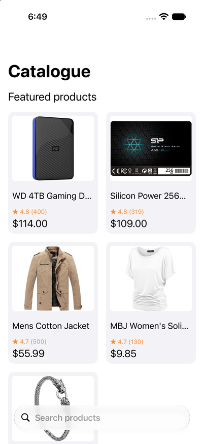
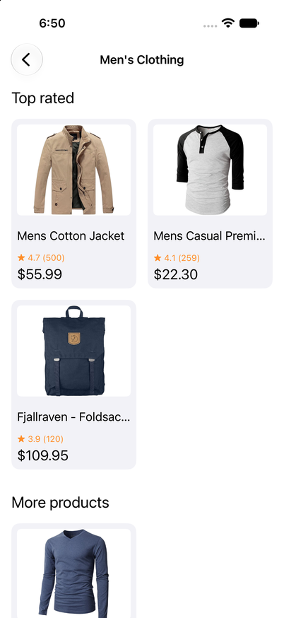
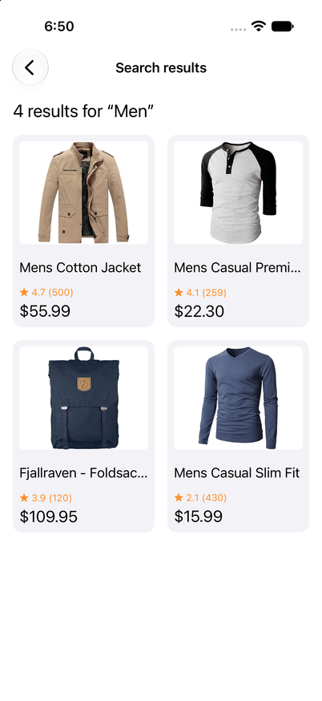
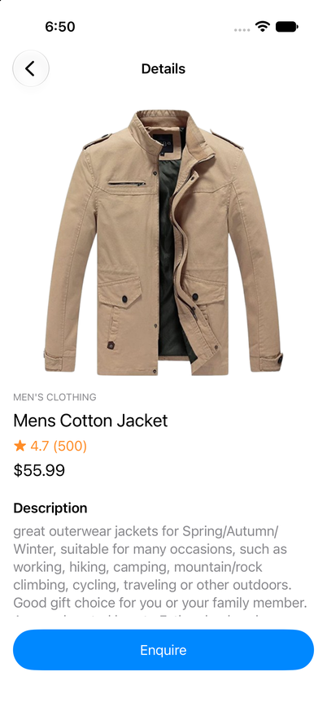
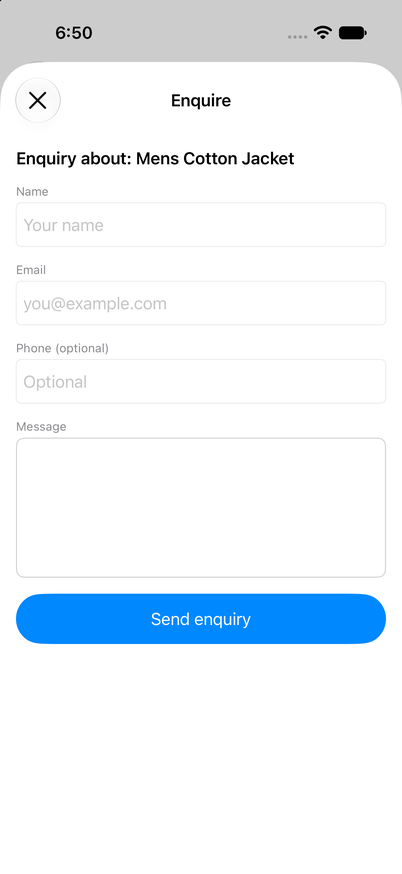
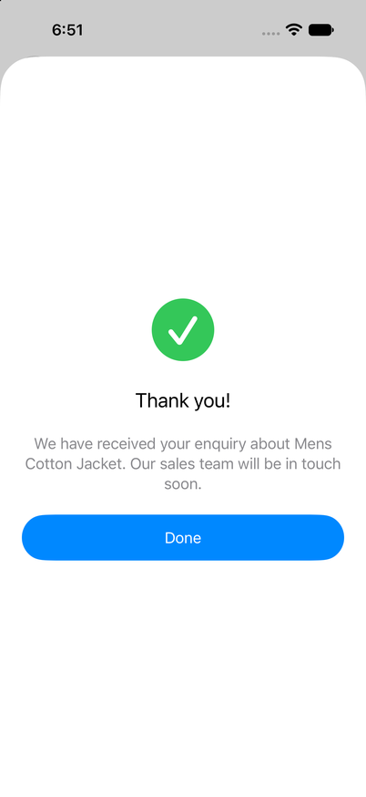
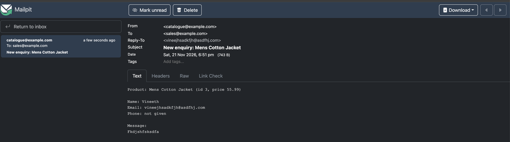

# Officeworks Product Catalogue

A small product catalogue: customers browse featured products and categories, search, open a product, and send an enquiry that lands in the sales inbox.

- **iOS app:** Swift, UIKit (code only, no storyboards, no SwiftUI), MVVM, async/await, no third-party libraries.
- **Backend:** Node.js, TypeScript, Express. The app talks only to this backend. The backend is the only thing that talks to the [Fake Store API](https://fakestoreapi.com).
- **Infra:** `docker-compose` (backend + [Mailpit](https://mailpit.axllent.org) as a local mail inbox). No paid services.

| Home | Category | Search | Details |
|---|---|---|---|
|  |  |  |  |

| Enquiry form | Thank you | Email in the sales inbox (Mailpit) |
|---|---|---|
|  |  |  |

## Run it (about 5 minutes)

You need **Docker Desktop** and **Xcode 27 or newer** (the project was created with Xcode 27.2 and uses its newer project file format, so older Xcode cannot open it). Node is only needed to run the backend tests.

1. **Start the backend and the mail inbox**
   ```
   docker compose up --build
   ```
   - API: http://localhost:3000 (try `curl http://localhost:3000/featured`)
   - Sales inbox (Mailpit): http://localhost:8025
   - No `.env` file is needed. Every setting has a default. Copy `backend/.env.example` to `backend/.env` to change settings.
2. **Run the app.** Open `ios/CatalogueApp/CatalogueApp.xcodeproj`, pick an iPhone simulator (iOS 17 or newer) and press Run (Cmd+R). The simulator reaches the backend at `http://localhost:3000` (set by `API_BASE_URL` in `Info.plist`).
3. **Try the flow:** Home (5 featured products) -> tap a category (top rated first, then the others) -> back -> type `men` in the search bar and press **Search** -> tap a product -> **Enquire** -> fill the form -> **Thank you**. Open http://localhost:8025 and the email is there.

Stop everything with `docker compose down`.

## Run the tests

```
cd backend && npm install && npm test           # 113 tests
cd backend && npm run test:coverage             # 100% coverage, the run fails below 95% (90% branches)
cd backend && npm run typecheck
```
```
xcodebuild test -project ios/CatalogueApp/CatalogueApp.xcodeproj -scheme CatalogueApp \
  -destination 'platform=iOS Simulator,name=iPhone 17' -only-testing:CatalogueAppTests     # 109 tests
```
(or Cmd+U in Xcode). iOS coverage of the app code is about 79%. The gap is mostly view code (cells and layout) that is checked by eye, see [DECISIONS.md](DECISIONS.md).

Optional check against the real Fake Store API: `cd backend && npm run try:fakestore`.

## Acceptance criteria

| Requirement | Where it lives | Tests |
|---|---|---|
| Home shows 5 featured products | `GET /featured`, `FeaturedService`, `HomeViewController` | `featuredService.test.ts`, `HomeViewModelTests`, `HomeViewControllerTests` |
| Category page: top rated first, then the others | `GET /categories/:name/products`, `CategoryService`, `CategoryViewController` | `categoryService.test.ts`, `CategoryViewModelTests` |
| Search shows only matching products, after tapping Search | `GET /products?q=`, `SearchService`, search bar sends only on the Search key | `searchService.test.ts`, `HomeViewControllerTests` (typing sends nothing) |
| Tapping a tile opens the details page | `AppRouter`, `ProductDetailViewController` | `AppRouterTests` |
| Enquire opens a form, submit emails the sales inbox, the customer sees "Thank you" | `POST /enquiries`, `EnquiryService`, `SmtpEmailSender`, `EnquiryViewController`, `ThankYouViewController` | `enquiryService.test.ts`, `smtpEmailSender.test.ts`, `EnquiryViewModelTests`, `EnquiryViewControllerTests` |

## How it is built

```
iOS app                                         Backend (Node + TypeScript)
View -> ViewModel -> APIClient (protocol)  -->  routes -> services -> ports -> adapters
                    URLSessionAPIClient          (HTTP)   (rules)    (interfaces)  FakeStoreProductRepository -> Fake Store API
                                                                                    SmtpEmailSender            -> Mailpit / SMTP
```

- **Ports and adapters.** Services only know two interfaces: `ProductRepository` and `EmailSender`. Only `FakeStoreProductRepository` knows Fake Store, and only `SmtpEmailSender` knows SMTP. Swap the product source for a database, or the email for SES, by writing one new class. A test (`architecture.test.ts`) enforces this.
- **The app never sees Fake Store.** The backend returns its own clean `Product` shape, so a change in Fake Store cannot break the app.
- **One error format** everywhere: `{ "error": { "code", "message" } }`.
- **iOS:** every screen is a ViewController plus a ViewModel. View models only know the `APIClient` protocol, so tests use a fake backend. `AppRouter` decides which screen opens next. Colours, fonts and spacing live in `Theme.swift`.

### API

| Endpoint | Answer |
|---|---|
| `GET /health` | `{ "status": "ok" }` |
| `GET /featured` | `{ "products": [...] }` (5 products) |
| `GET /categories` | `{ "categories": [...] }` |
| `GET /categories/:name/products` | `{ "category", "topRated": [...], "others": [...] }`, unknown name: 404 |
| `GET /products?q=` | `{ "query", "products": [...] }`, missing or blank `q`: 400 |
| `GET /products/:id` | one product, bad id: 400, unknown id: 404 |
| `POST /enquiries` | `{ name, email, phone?, message, productId }` gives 201, bad input 400, unknown product 404, too many 429, email failed 502 |

## Assumptions and trade-offs (short version)

Full list and reasons are in [DECISIONS.md](DECISIONS.md).

- **"Featured" and "top rated" are defined by us:** featured = 5 configured product ids (default: the best rated); top rated = the top 3 by rating in a category.
- **Search matches whole-word starts,** so `men` finds men's products but not women's.
- **No database.** The brief only asks for an email, so an enquiry is emailed and logged (without personal data). Storing enquiries is the first thing I would add.
- **The email is sent before we say "Thank you".** If sending fails, the customer sees an error and can retry. They never get a false thank you.
- **Enquiries are rate limited** (5 per 15 minutes per IP address, in memory).
- **iPhone only, portrait, iOS 17+.** One layout, deliberately.
- **Prices show `$`,** because the catalogue has no currency field.

## What I would do next

See the end of [DECISIONS.md](DECISIONS.md). In short: CI, store enquiries, a real email provider, tests for the remaining view code, and an AWS deployment of the same Docker image.

## Working notes

- [PLAN.md](PLAN.md): the plan and the 13 steps.
- [DECISIONS.md](DECISIONS.md): assumptions, design choices, what was cut and why.
- [AI_USAGE.md](AI_USAGE.md): how AI was used, where it was wrong and how that was caught, and a time log.
- [CLAUDE.md](CLAUDE.md): the rules given to the AI assistant.
